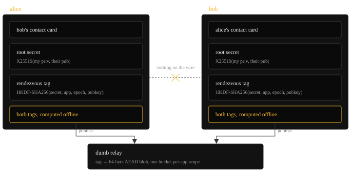

zafu's first libraries are on npm. They exist to give an application one property: the server holds the user's data and cannot read it, and the user does not have to run anything to get that.

Encryption is the easy half of that. The hard half is that encrypting to someone requires knowing their key, and key distribution is a coordination problem that has defeated every system which treated it as secondary. PGP is the canonical failure: the cryptography was sound and the key exchange was so unpleasant that nobody onboarded a second person. The adoption that did happen moved to hosted mail with the trust assumptions that implies. FROST multisig now has the same problem in a new form. The threshold math is settled — a 2-of-3 spend never assembles a key anywhere — but it says nothing about how three parties reach each other, and that is the part that decides whether a multisig is usable.

So the libraries are split along that seam: key agreement, then identity and transport, then the composition layer that lets the transport be swapped.

## The SDK

- **[`@zafu/pq`](https://www.npmjs.com/package/@zafu/pq)** — key agreement. X25519 mixed with ML-KEM-768, which is [X-Wing](https://datatracker.ietf.org/doc/draft-connolly-cfrg-xwing-kem/), a sealed box over it, and raw ML-KEM for protocols that bring their own X25519. Every agreement is hybrid: an attacker must break both halves.
- **[`@zafu/zid`](https://www.npmjs.com/package/@zafu/zid)** — identity and transport for websites. Site-scoped login by signing a server nonce. A sealed box for messages whose recipient is offline. A live hybrid Noise IK channel, `zafuNoise_IKhybrid_25519+MLKEM768_ChaChaPoly_SHA256`, which fails closed rather than downgrade for a classical-only peer. A contact picker that returns opaque handles and never exposes a social graph.
- **[`@zafu/protocol`](https://www.npmjs.com/package/@zafu/protocol)** — the message contract the wallet bridge and the page both compile against, so there is one definition of what crosses the wire.
- **[`@zafu/media`](https://www.npmjs.com/package/@zafu/media)** — peer-to-peer voice and video, perfect negotiation, optional background blur. SDP and ICE ride the encrypted zid channel; the media itself is direct WebRTC and therefore reveals each side's address, so calls are opt-in.
- **[`@zafu/service`](https://www.npmjs.com/package/@zafu/service)** — the composition layer. A service is a function from request to response, a filter wraps one service in another, and a strategy is a named stack of filters an application binds to. Every seam is injected, so the same code runs against the extension, against in-page guest keys, or against a relay, and deadlines, retries and tracing are filters rather than a branch at each call site.
- **[`@zafu/interactions`](https://www.npmjs.com/package/@zafu/interactions)** — wallet approvals, and the first of these that faces the user rather than the server. An application declares an intent; the wallet decides where it is presented, from a preference set once. The approval surface is part of the user's trust environment, like the choice of signing keys, so it is not delegated to the application.

Signatures throughout are plain ed25519. A signature contains nothing to harvest and cannot be forged retroactively, and on the day quantum computers can mint new ones the whole ecosystem rotates signature schemes together. Key agreement is the asymmetric case: traffic recorded today is decrypted years from now, so that is where the post-quantum budget is spent.

`zid.connect()` works with no wallet installed. It derives a guest identity from a single in-page seed — an ed25519 identity and an X-Wing keypair — held in memory and burner-grade. An application is usable before anyone installs anything.

## Contact discovery without a directory

Signal's private contact discovery is an attested enclave with an oblivious-RAM layer over a directory of phone numbers. That construction needs a directory: something to look names up in. ZID keys are random, so no directory exists, and the only handle anyone has on a friend's key is a secret the two of them already share.

Two parties holding each other's contact card derive the same pairwise root secret locally, each from their own private key and the other's public key. Nothing is sent, and neither has to be online. From that secret each derives rendezvous tags by HKDF-SHA256 over the secret, the application origin, the epoch, and the publisher's public key, which makes the two directions of a friendship unlinkable.

Epochs come from [JAM common era](https://graypaper.fluffylabs.dev/#/07f041d?v=0.8.0): six-second slots from a fixed genesis, bucketed into five-minute windows against each side's own clock, so there is nothing to negotiate. A slot is a u32 count of six-second ticks, which runs into the 2840s.

*Neither side ever messages the other: each computes both tags offline and looks for the other's.*

Presence is published to a key-value relay under the tag, as a 64-byte AEAD blob with the epoch as associated data, so replaying an entry into a later epoch fails. Rotating tags conceals the value but not the access pattern: a relay answering one GET per tag and seeing one PUT per friend learns friend counts and can reconstruct the graph. Clients therefore never read per tag. They download the entire bucket for an application scope and match locally, and writes are padded to a constant — 64 entries per epoch, real tags shuffled among dummies.

Matching is a lookup rather than a search. You compute the tag a given friend would publish under and test the bucket you already hold. Exactly two parties can derive that tag, so a hit means that friend is present and the relay learns nothing about who asked. The application sees only the intersection: a handle, an ephemeral session public key, capability bits.

The cost is linear in publishers. At 64 entries each, ten thousand users in one scope is roughly 50 MB per client every five minutes, which is why the design targets thousands per scope. Prefix sharding is available and divides the bucket at the price of revealing which prefix was touched.

The wallet half is implemented: the extension answers `zafu_discover_contacts` under application-scoped handles, behind a privacy setting that is off by default. The relay is deliberately trivial — two routes over one SQLite table, no crypto, no accounts. [minirelay](https://github.com/rotkonetworks/zafu/tree/main/apps/minirelay) is the reference implementation and runs at `relay.zafu.pro`, which is the extension's default, and being this dumb is what makes running your own practical.

## What this does not do

**Post-compromise security.** The live channel re-keys every 256 messages from the previous key, so a key stolen today does not read traffic from before the last re-key. Recovery from compromise is the missing property. An attacker who reads device memory once and takes the live session key can decrypt the remainder of that session, because every subsequent key descends from one they hold. [Signal's SPQR](https://signal.org/blog/spqr/) closes this by carrying post-quantum key material in every message header of a 1:1 session. That shape does not fit here — zafu's channel sends fixed-shape frames and its rooms broadcast one ciphertext to all members — so the plan is a fresh ML-KEM exchange folded in at each re-key. It is not built.

**Forward secrecy in discovery.** The secret behind a rendezvous is a static X25519 value, which is the price of a lookup requiring no round-trip. An adversary who records the relay and later obtains a contact key, or who has a quantum computer and the two public keys, can reconstruct who was online when. This leaks metadata and graph shape, never message contents. Two fixes are queued: rotate contact keys, and ship `xwing-v1`, giving each contact its own [XID](https://hackmd.io/@bc-community/SkdxVyY11g) so an identifier survives rotation and two contacts cannot correlate theirs. X-Wing is a KEM, not a NIKE, so one side must send a ciphertext, and neither the 1216-byte key nor the 1120-byte ciphertext fits in a Zcash memo beside the card. The exchange therefore runs once over the hybrid channel at first connection and is cached. The first rendezvous between two contacts remains classical.

**Bucket growth.** Linear cost in publishers means a large enough scope outgrows the whole-bucket download. [Penumbra](https://protocol.penumbra.zone/main/crypto/fmd.html) ships the relevant primitive: fuzzy message detection, where a detection key lets a scanner answer "possibly yours" with chosen false positives and no false negatives — 68-byte clues, a 32-byte detection key, and precision set from the observed clue rate, so about one entry in 65,000 at 16 bits. Applied here, a presence entry would carry a clue against a clue key published in the contact card. The cost is that matching scans every entry, which is what makes it unindexable, so the scanner must be per-user — self-hosted or the wallet — and that scanner learns a measurable fraction of the friend set. The bucket is correct at current sizes; FMD is the answer when a scope outgrows it.

**Network-level metadata.** None of this conceals who connects to whom. A relay still observes addresses, timing and volume. [Nym's mixnet SDK](https://zcash-sdk.nym.com/guidance/) builds on Zcash primitives and runs in the browser, and is on the roadmap for paths that can absorb the latency. Calls are excluded by construction: direct media means no intermediary holds it.

## Why a browser extension

Zcash has competent desktop and mobile wallets, and a browser extension will not out-secure or out-mobile them. What the browser has is a social layer and the ability to extend software people already run. That is the argument for putting the spending keys somewhere else entirely: on Zigner, an air-gapped signer that communicates with the wallet through animated QR codes and nothing else. With keys cold, the hot extension is free to be a poker table, a client for a model running in a TEE, or any application that would otherwise hand a server plaintext.

The same split makes multisig and escrow tractable. FROST gives the threshold math; a ZID is an identity contacts already hold, a contact card opens a private channel, an invite turns a stranger into a counterparty, and presence says who is online. With those, an escrow is a flow rather than a protocol project, and the signing still happens on the cold device.

Key custody is hard and fails silently, and nobody whose revenue depends on reading the data has an incentive to improve it. That pressure is increasing: models are approaching the point where they find and exploit software flaws unaided, so services will be breached at a higher rate and the data will spill. Client-side encryption is the only part of that chain a user controls.
